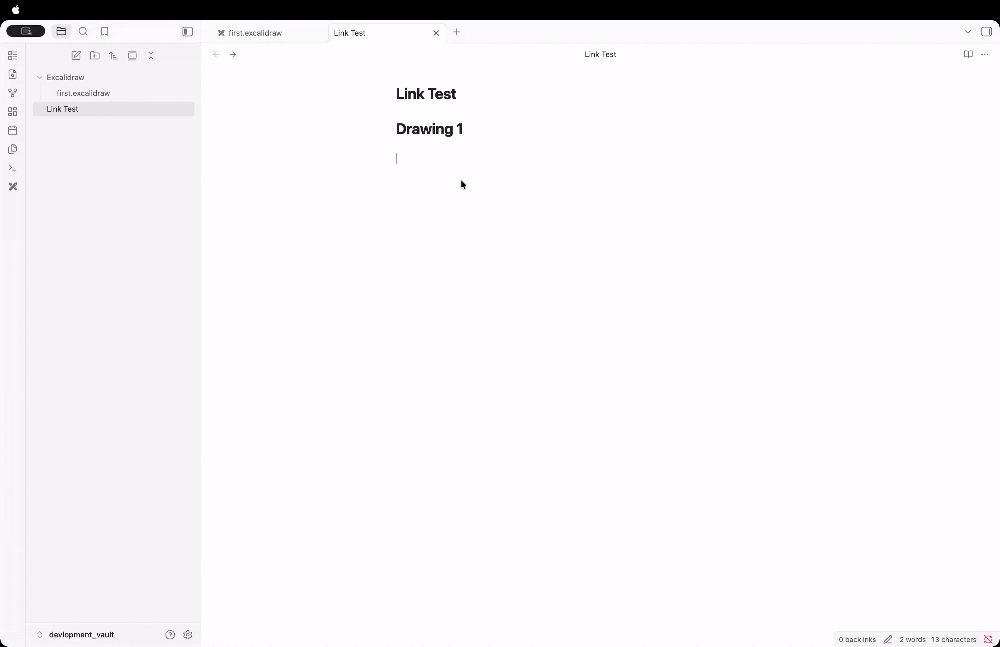

# Excalink

Suggests and links the named **frames** and **groups** inside your
[Excalidraw](https://github.com/zsviczian/obsidian-excalidraw-plugin) drawings
as you type `[[filename#` in the editor.

## Demo



## How it works

1. Give a frame a name in Excalidraw, or select a few elements and group them
   (add a text element inside the group if you want it to have a name too).
2. In any note, start typing `[[my-drawing#` — Excalink detects the pattern
   and opens a fuzzy-search picker of every frame and group in that drawing.
3. Filter with fuzzy search, pick one with `↑↓` + `↵`, and Excalink completes
   the link for you:
   - Frames: `[[my-drawing#^frame=FrameName]]`
   - Groups: `[[my-drawing#^group=elementId]]`

Both formats are the block-reference syntax already understood by the
Excalidraw plugin, so the resulting links embed and navigate correctly.

Unnamed groups still show up in the picker — Excalink looks for a text
element inside the group to use as its label, falling back to a generic
`Group N` name if none is found.

## Settings

Available under **Settings → Community plugins → Excalink**:

- **Enable suggestions** — turn the picker on or off entirely
- **Include frames** / **Include groups** — choose what shows up in the picker
- **Show recent first** — most recently added frames/groups appear at the top
- **Max suggestions displayed** — cap the picker's list size
- **Show file context** — show the source filename under each suggestion

A **Rescan vault** action (in settings, or via the command palette) rebuilds
the index on demand; it also updates automatically when Excalidraw files
change.

## Installation

### From Obsidian Community Plugins

1. Open **Settings → Community plugins → Browse**
2. Search for "Excalink", click **Install**, then **Enable**

### Manual installation

1. Download `main.js`, `manifest.json`, and `styles.css` from the
   [latest release](https://github.com/AarambhaAnta/Excalink/releases)
2. Copy them into `VaultFolder/.obsidian/plugins/excalink/`
3. Reload plugins in Obsidian and enable Excalink

### Development setup

```bash
git clone https://github.com/AarambhaAnta/Excalink.git
cd Excalink
npm install
npm run dev    # watch mode
npm run build   # production build
```

## Changelog

### 1.1.0

- Added group support: grouped elements are now suggested and linkable
  alongside frames, with automatic name detection from nearby text
- Reorganized the codebase into `src/`
- Trimmed the settings panel to the options people actually use
- General security, styling, and logging cleanup for community plugin review

### 1.0.x

Initial release: frame detection, fuzzy-search suggestion modal, caching,
file watching, and a full settings panel.

## License

MIT License — see [LICENSE](LICENSE) file for details.
